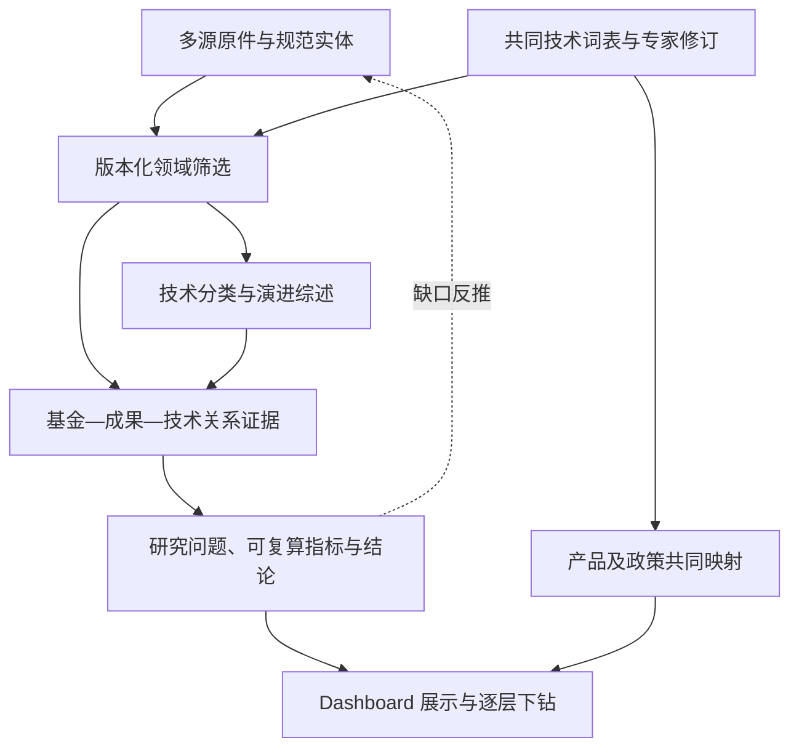

# 项目背景与研究主线

本说明面向首次接手 Dashboard 的协作团队及其 AI 开发工具。交接状态截至 **2026-11-05**；数据规模以各自发布批次为准。它说明研究目标和共同语言，具体成果、数字及页面约定分别维护在其余三份文档。

## 1. 项目要解决什么问题

国自科项目的核心交付是“基础研究支撑经济发展全链条数据系统构建与集成”。基础研究先形成知识，继而通过方法、技术、企业和产品进入产业活动；政策在不同时间和对象上发挥作用。这些过程的记录分散在基金项目、论文、专利、机构、企业、模型、产品和政策资料中。

本项目建设贯通**创新链、产业链、政策链**的多源数据基础，回答：某项技术的知识来自哪里？它与哪些基金项目及研究成果有可核查联系？成果如何进入后续研究和技术研发？哪些产品与产业活动采用了相关技术？政策作用于谁、何时发生、能否进一步开展效果研究？

当前总协调负责的研究重点是技术供给一侧，主问题为：**国家自然科学基金支持了哪些技术方向，形成了怎样的科研与技术成果，这些成果如何支撑后续技术发展，并产生持续的知识影响？** 基金投入的经济回报与政策因果效果属于后续跨侧研究，不能由论文量或关系条数直接推出。

## 2. 从全领域底座到技术供给研究

长期建设全领域、多来源、可持续更新的数据底座；当前重点专题是人工智能，尤其是 LLM 及其相关支撑、服务和应用。低空经济是独立保留的示范领域。不能因为近期集中研究 LLM，就把已有底座改称仅含 LLM；也不能把广义 AI 全部记录称为狭义大语言模型记录。

研究主线是“**资助布局 → 成果形成 → 技术支撑 → 影响传播**”，细分为四类八问，见[当前成果与研究计划](02_当前成果与研究计划.md)。工作既由已有数据向上产生分析，也由研究问题向下反推字段和补源需求。无需等到全领域资料齐全才做专题；同时不能把少数典型案例当成总体。

## 3. 三条链怎样连接

| 链条 | 主要对象和问题 | 当前协作边界 |
|---|---|---|
| 创新链／技术供给 | 基金项目、论文、专利、研究人员、机构、技术能力；研究支持、成果形成、技术联系和知识传播 | 总协调维护范围、词表、综述、关系解释、指标和展示；数据负责人提供规范实体、来源与关系资产 |
| 产业链 | 企业、模型／服务／产品版本、应用任务、经营与就业等观测；相关技术如何进入实际活动 | 产业研究同事负责专业研究，总协调对齐技术 ID、对象、时间与证据接口 |
| 政策链 | 政策文本、对象、工具、地域、时间和实施背景；政策覆盖与效果 | 政策研究同事负责专业研究，总协调接入可追溯结果 |

产业衔接的具体路径是“技术脉络与论文 → 技术能力 → 模型／服务／产品版本 → 应用任务 → 产业观测”。算力支撑、平台提供、技术采用和技术继承是不同的关系。政策涉及对象、工具、地域和时点，不能只靠关键词相同就认定适用或产生效果。

团队已有职责约定不等于具体交付字段已由所有同事确认。尚未收到的产品、产业或政策成果在页面保持“筹备中”；不要写成已经完成的三链闭环。

## 4. 共同技术结构：7 类、29 组、70 词

共同工作基线由用户在 **2026-09-18** 讨论确认，源于《人工智能技术关键词.xlsx》。版本标识为 `ai_keywords_7class_20260918_v4`。七类分别为：

1. 基础模型与架构。
2. 模型训练、适配与推理。
3. AI 算力与运行优化。
4. AI 云与平台服务。
5. 知识增强与 AI 应用。
6. 数据与知识服务。
7. 模型评测与安全。

七类用于整体比较，29 组用于分支分析，70 个关键词用于检索、证据组织和逐技术点综述。完整分组见[当前成果与研究计划](02_当前成果与研究计划.md#共同词表完整目录)。稳定关键词身份采用 `AIK` 编号，本版主题 ID 采用 `AI1.xx` 至 `AI7.xx`；主题 ID 和展示名称均不能随视觉设计重新赋义。

范围包括算力、平台、数据服务和应用，不统一附加“language models”检索限制。同名技术仍应遵循该词的研究定义，不能自行扩成所有模态或所有行业。技术树表达分类；演进时间图表达具体方法、论文与时间关系，两者分别保留证据。

该基线为用户确认的工作范围，**尚不等于全部专家审定或逐来源检索质量验收完成**。旧 AIGC 125 词、旧 54 主题及中间方案仅作历史追溯。旧筛选快照不能换上“70 词”的标签；最新统一研究集合也应使用自己的筛选与合并规则，而非宣称由 70 个精确词穷尽命中。

## 5. 为什么 Dashboard 是研究交付入口

Dashboard 让团队从规模进入结构，从结构进入关系，再从关系回到材料。它应帮助读者判断“观察了什么、看到了什么、证据在哪里”，并支持技术树、综述、年度趋势、关系图和案例下钻。

五个固定入口为：**数据总览 → 领域数据 → 技术演进 → 证据链 → 案例专题**。首页描述项目已有资产；从领域数据开始切换人工智能／低空经济。两领域沿用各自技术结构和分析口径，不能为统一视觉而强行统一数据含义。

页面面向科研讨论与汇报，采用清楚、克制的中文表达。重要状态和统计范围应可见，详细运行记录与技术限制放在文档和证据层。标题要兼顾基础研究、产业发展和政策协同，不能把整个项目缩成仅创新链。具体页面和交互要求见[Dashboard 页面与内容约定](04_Dashboard页面与内容约定.md)。

## 6. 开发与研究共同遵守的判断规则

| 观察或关系 | 可以表达 | 需要更多证据才能表达 |
|---|---|---|
| 明确基金号或官方成果登记 | 某论文与某项目存在登记／资助联系 | 该项目独占全部成果贡献 |
| 关键词及上下文命中 | 记录属于某技术候选或规则分类 | 专家已确认技术归属、企业实际采用 |
| 论文引用 | 后续论文引用了该成果 | 直接使用其算法、商业转化或经济收益 |
| 专利中的论文引文 | 科学知识与专利文本存在可核查联系 | 技术已实施、产品采用、专利价值或因果贡献 |
| 同名同机构、作者共现 | 人员候选、合作观察 | 已统一的唯一人员、真实团队规模或人才流动 |
| 论文署名机构 | 机构参与该论文 | 全体作者都属于全部机构、作者国籍、全国贡献比例 |
| 原批准经费及执行期 | 在研项目的批准经费规模 | 当年实际拨款、实际支出或资金收益率 |

页面上的关系数量、节点大小和色深必须对应已定义的统计量或讲解规则。缺失记为未知，候选保留候选标签，零值必须有完整观察依据。质量不足时保留明确空态，不通过补造记录使画面完整。

核验依据：原项目《项目总览》研究主线及职责章节；《工作方法》共同词表、八问框架和统计约定；《当前进展与计划》2026-11-03—05 更新。本文不把历史会议中未导出的经济贡献六维内容补写为已确认结论。
