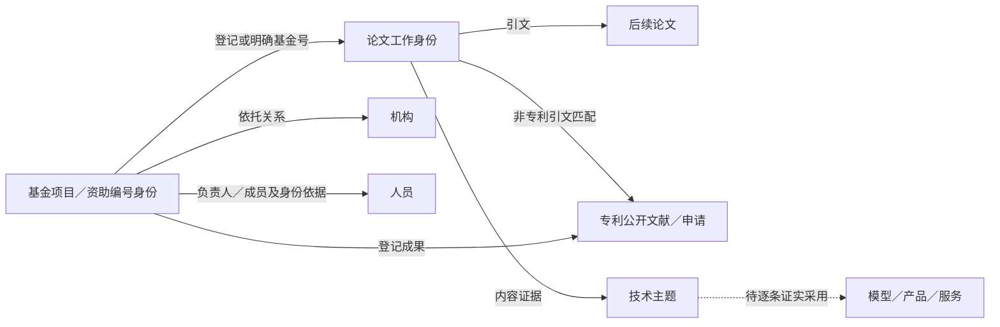

# 数据资产与统计口径

本文记录 **2026-11-05 交接时采用的数据版本**，其中最新规模快照日期为 **2026-11-03**。它解释页面数字来自哪一层、能回答什么、还缺什么。数据规模不因前端刷新而变化，旧分析也不会因为接入新库自动重算。

## 1. 先分清五层数据

| 层次 | 内容 | 应怎样计数 |
|---|---|---|
| 原件与来源观察 | 原始文件、API 响应、来源字段、文件 SHA、行位置及拒绝记录 | 按来源／批次计记录；不同来源和副本不相加为唯一实体 |
| 规范实体 | 统一论文、项目工作身份、专利公开文献，以及原 ID 到规范 ID 的映射 | 使用该版去重规则；仍需保留来源冲突、工作身份和版本区别 |
| 领域集合 | AI 论文、AI 主项目、AI 专利及低空专题 | 记录筛选／并入规则；专题可重叠，不能加到全领域总数上 |
| 关系与研究派生层 | 基金—论文、人员观察、引文、研究队列、年份补充、技术分类和模型结果 | 实体数、关系对数、原始证据行分别计；每问使用固定样本 |
| 展示发布层 | 已验收 JSON、综述阅读包、图表数据、人工更新台账 | 只消费指明的发布版本；显示刷新不等于采集或入库完成 |

同一论文可对应多个基金项目；论文数按论文去重，项目数按项目去重，边数另报。一个专利申请可有多个公开版本，还可属于一个简单同族。项目负责人、论文作者、发明人和成员是不同角色，不能把角色记录数当唯一人员数。

## 2. 最新统一规范库：规模与版本

| 指标 | 数量 | 范围与单位 | 有效版本 |
|---|---:|---|---|
| 跨来源规范论文 | **140,781,506** | 全领域规范论文身份，篇；不是全球全部论文 | `paper_unified_20261030_v1` |
| AI—LLM 论文研究集合 | **3,119,247** | AI 统一研究集合，篇；广泛规则与同义表达筛选，合入既有 AI 集合和 AI 基金关联论文 | 同上 |
| AI 主项目 | **21,078** | 固定 AI 主项目集，项 | 论文规范库及关系发布层 |
| AI 全部登记成果关系 | **388,629** | 论文、专利及其他原登记类型，关系条；不是论文篇数 | 同上 |
| 基金工作身份 | **733,190** | 全领域项目及从文献识别的资助编号身份，个 | `innovation_relations_20261102_v1` |
| 全国专利规范目录 | **56,903,567** | 按公开号去重，条；全国来源目录，不能写全国全部专利 | `patent_unified_20261030_v1` |
| AI 专利公开文献 | **8,469,646** | AI 大包与智慧芽合并、按公开号去重，条 | 同上 |
| AI 专利申请 | **6,501,036** | 以上 AI 集合的申请身份，件 | 最新展示适配快照 |

AI 论文属于研究集合，不是全部通过专家语义确认的狭义 LLM 论文。AI 基金的全部登记成果予以保留，不要求每条成果再次命中技术词；因此“与 AI 项目有关”与“成果内容明确属于某技术”应分别标注。

AI 专利合并对账为 **8,414,270 个 AI 包公开号 + 90,000 个智慧芽公开号 − 34,624 个重合 = 8,469,646 个**。同公开号的共同字段优先采用智慧芽非空值，再由 AI 包补空；专属字段和来源依据保留。该集合不能改称按本项目 70 词完整重筛的专利全集。

首页的四项大数沿当前审定设计：文献 **140,781,506 篇**、基金项目 **428,409 条**、专利 **56,903,567 条**、招聘 **7,284,624 条**。其中基金和招聘沿原首页口径，基金工作身份 **733,190 个**另在资源明细展示。二者不是同一指标。历史临时专利演示数 **6,904,000** 已移除；旧公开文献数 **56,903,568** 属于旧验收版本，不能覆盖当前规范库数。

## 3. 关系层：有哪些边，缺口在哪里

当前关系版为 `innovation_relations_20261102_v1`。它整理既有基金、论文、AI 专利、CFRR 来源及研究证据，论文／专利全字段仍按 ID 连接 10 月 30 日的规范主库。关系建表不会自动补齐近期基金或原始字段。

| 关系或观察 | 数量 | 解读 |
|---|---:|---|
| 全领域基金—论文 | **4,129,661 对** | 官方登记、已有研究关系及明确 NSFC 项目号关系，证据另存 |
| AI 基金—论文 | **371,805 对** | 连接 19,092 个主项目、352,724 个论文工作身份；不同于论文篇数或全部 AI 论文规模 |
| 基金—人员来源记录 | **430,949 条** | 含角色与来源身份，不是唯一研究者数 |
| 论文—作者来源记录 | **23,069,266 条** | AI 论文来源观察，保留重复来源和身份依据 |
| 人员—机构观察 | **6,872,322 条** | 观察记录，不等于已核实任职变动或人才流动 |
| 论文引用 | **45,640,072 对** | 本地关系层引用网络，不是完整全球被引 |
| CFRR 专利—论文来源记录 | **13,905,635 条** | 大量保留外部 OpenAlex ID，不能直接视为已接到本地论文 |
| 已接通专利—论文规范关系 | **22,939 对** | 已匹配关系；与 CFRR 原始观察规模分开 |
| 基金—专利 | **35,342 条** | 登记专利关系；与“基金论文被专利引用”是不同路径 |
| 负责人资助接续候选 | **140,462 条** | 全领域项目对；其中大量基于姓名＋机构，不能全部当确认的同人接续 |
| 成果作者后续主持基金 | **0 条** | 关系尚未接通，不代表现实中不存在这类现象 |

关系层建议按以下逻辑理解，而非把每张表单独画成一个总量：

典型逻辑入口包括 `project_detail_summary`（基金详情）、`project_paper`／`project_paper_evidence`（论文关系及证据）、`project_outcome`（全部登记成果）、`organization_year_activity`／`person_year_activity`（年度活动）、`research_group` 及成员观察表、`citation_edge`（引用）、`resource_use_evidence`（实际使用证据）。这些是关系层的数据契约提示，不表示协作仓库包含原数据库。

## 4. 研究力量必须保留的分层

最新页面采用 **7,032 项目／727 机构**的研究力量样本；机构支持年度主比较聚焦 2017—2021，后续成果观察到 2025。负责人接续只采用至少一端属于 AI、两端均有直接官方人员标识的 **286 条关系／278 个工作身份**。这两个样本不能替换 AI 主集 21,078 项，也不能被全领域 140,462 条候选接续替代。

已识别的关键缺口为：

- AI 项目中有 63 项出现同名负责人多身份；金额必须从项目表汇总，不能因人员联结重复计资助。
- 同名同校不一定同人；需要院系、履历、主题、来源 ID 等证据。人员主表有官方 ID，不表示每条项目关系的两个端点都有直接官方 ID。
- 项目侧与论文侧存在中英文机构身份未归并的问题。当前成果沿项目 ID 归到依托单位，不把论文署名机构混成项目承担单位。
- 17,875 个研究群体是按负责人及其项目成果作者组织的工作集合；AI 仅 4,776 项有成员资料。跨论文作者身份尚不稳定，不能计算真实团队规模、人员流失或成员接续率。
- 352,724 个 AI 基金关联论文身份中 **147,240 个缺发表年（41.7%）**；另有 4,920 条关系的论文早于项目启动、430 条早于批准，需要继续核查关系和日期。
- 主集 2023／2024／2025 年批准项目仅 **46／12／4**，2025 年 4 项均无金额；没有纳入主集的 2026 年批准记录。近期尾部不可解释为实际资助活动骤降。

机构“首次观察”按现有 AI 主集历史记录识别，不是机构成立年或历史首次获资助。多人共同署名、合作观察、直接项目成员和负责人应分别显示。

## 5. 论文与专利字段覆盖

以下论文覆盖的分母统一为最新 **3,119,247 篇 AI 论文**，取自同一展示快照。非空表示有字段，不能等同字段准确或证据已经审定。

| 字段 | 非空记录 | 非空比例（四舍五入） |
|---|---:|---:|
| DOI | 2,610,809 | 83.70% |
| 发表年 | 2,940,659 | 94.27% |
| 摘要 | 1,250,712 | 40.10% |
| 作者 | 3,064,700 | 98.25% |
| 机构 | 1,067,640 | 34.23% |
| 资助信息 | 590,020 | 18.92% |
| 参考文献 | 1,646,919 | 52.80% |

类型构成为期刊 2,137,461、会议 766,046、预印本 213,752、未知 1,988，合计与 AI 主集一致。资助字段非空不是 NSFC 资助比例，也不等于已连接具体项目；未知不能填成“无资助”。基金来源本身按资助选入，不能单独估计领域总体资助覆盖率。

全国专利规范目录主要提供标识、日期、主体、分类和原件定位；摘要、主权项仍可回到原件。AI 专利主表已装入摘要、第一权利要求、主体、分类、日期与来源专属字段。申请年、公开年、授权年分别保存；当前领域主年度图使用申请年。全国目录字段与 AI 深度字段不能混称全库覆盖。2025—2026 尾部同时受快照和公开时间影响。

## 6. 其他资产与独立领域

论文来源包含 Crossref、DBLP、CNKI、万方、历史与近期基金成果，以及检索／原文补充。原始来源计数、来源快照和规范后的论文集合是不同层次。例如 Crossref 原包包含其他学术对象，不全是期刊／会议；DBLP 含预印本和非正式记录；基金成果还包括专著、奖励等。不得简单相加得出“论文总量”。

| 其他资产 | 已知覆盖／现状 | 展示边界 |
|---|---|---|
| AI 政策规范交付 | 8,563 个来源身份、11,073 条交付观察、11,014 个正文及元数据版本；2001—2026，16 个缺年份 | 三个数分别计量；检索集合可重叠，尚非逐篇实质 AI 确认；不含低空 |
| AI 企业候选 | 39,251 行候选名录 | 多来自经营范围词命中；不是已确认技术采用企业，经营／融资字段尚不齐 |
| 上市公司 AI 年度面板 | 2001—2025 年；未筛 70,999／筛后 66,672 个公司年度观察 | 词频和年度面板，不是年报全文，也不是独立企业数 |
| AI／跨行业报告 | 历史交付含 AI 1,971 份 PDF 与跨行业 422 份 PDF，另有压缩包 | 按文件和内容版本解释，包内副本不相加；不代表均属于 LLM |
| OpenScholar 文本与向量 | 32 个文本片约 277.24 GB、31 个原向量片约 272.09 GB，按既有验收 | 文本 chunks、向量、编码器、重排器和引用池是检索依赖；体积不是论文数，语料较旧；原向量缺片与专题补算另存证据 |
| 低空原始与规范库 | 原专利交付 265,771 条；旧规范库基金 1,588、成果身份 4,923、专利 120,000 | 原件与规范子集不相加；4,923 成果中期刊 3,347、会议 989，其余 587 为其他成果 |
| 低空其他资产 | 软著、企业／主体、产品、新闻、政策、报告、经营与招聘等 | 独立保留原版本、接口和技术树；不借 AI 新库替代低空数据 |

上述“其他资产”沿各自历史验收记录引用，并非本次重新全量核验。可用字段、快照日期和旧版缺口要随来源说明保留。政策有文本不等于政策效果已分析；企业候选有记录不等于产品采用已确认。

## 7. 研究派生版本与页面数据的对应

| 产物 | 采用版本／样本 | 不应混入的数字 |
|---|---|---|
| 前六问报告 | `midterm_ready_20261026_v1` → `six_questions_20261026_v2`；21,078 主项目，337,731 对项目—论文关系；各问另选队列 | 不把最新 371,805 对直接替换旧系数或结论 |
| 1.1 七类在研支持动画 | 21,078 主集筛出执行期重合的 12,490 项；2017—2025 按执行年纳入原批准经费 | 不是当年新增批准金额或实际拨款；不同年份同项目出现不应累加为累计投入 |
| 七类成果／曲线 | 固定 8,043 项母队列；七类宽主题论文累计 51,464；七类年度专利累计 20,401 | 不是全体 AI 论文／专利；历史静态登记 26,616 与按年动画不混用 |
| 70 技术点专利分布 | 2017—2025 可分类 6,284 件、覆盖 49 个技术点 | 不拿它替代七大类 20,401，也不声称 70 个词都有专利 |
| 研究力量 | 7,032 项／727 机构及 286 条官方身份接续等已验收样本 | 不以全部 AI 项目或全领域姓名匹配候选替换样本 |
| 技术树／综述 | 当前 70 词分类和 70 篇 Skills 可读综述 | 目录数、参考文献数不是领域规模；旧专题图仍标旧样本 |

多技术归属的项目、金额和成果按照已冻结规则分摊，展示整数需要保持合计守恒。项目技术方向不能无条件赋给全部论文；若某版允许采用项目主题回挂，必须保留“成果内容识别／项目主题关联”区分。具体内容演示要求见[Dashboard 页面与内容约定](04_Dashboard页面与内容约定.md)。

## 8. 更新与来源追溯

正式统计应能回到来源批次、原 ID／规范 ID、输入 SHA、筛选／匹配版本、拒绝及冲突记录、质量回执、输出发布版本。已接收、已验收、已规范入库、已用于展示是不同状态；研究计划、采购数量、可打开的外部网页不能直接计入已入库资产。

更新动态现为独立人工展示台账，历史至 10 月 10 日部分日期采用补录示意规则。它不是逐日采集审计，也不自动改变后台资产和上述规模。平台后续补录应使用同一内容文件，详细约定见[Dashboard 页面与内容约定](04_Dashboard页面与内容约定.md#更新动态唯一人工入口)。

核验依据：数据负责人《已有数据一览》的“论文统一规范库”“专利统一规范库”“基金中心关联库”最新章节；原项目《数据现状与入库》2026-11-03 关系复核及前六问版本；`current-inventory-20261103-v1` 展示快照和当前前端适配器。协作仓库交付哪些资产以仓库清单为准，本文不把原数据库视为已随代码上传。
