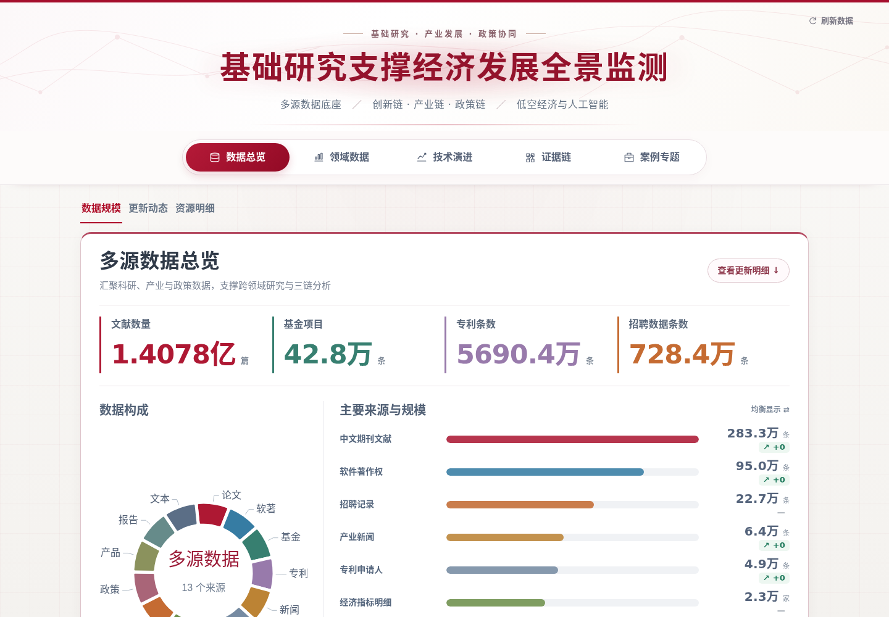
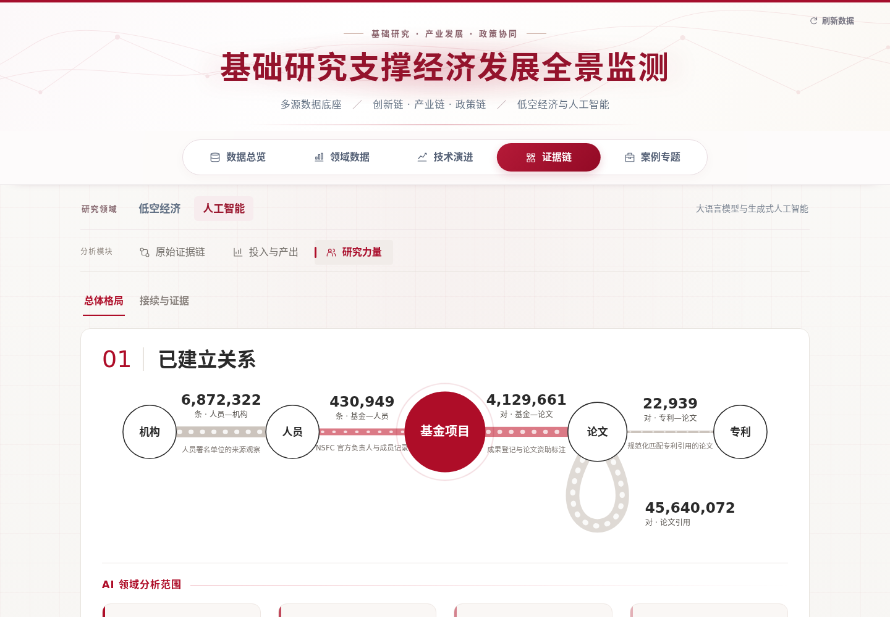

# Dashboard 页面与内容约定

截至 **2026-11-05**，有效展示为六页、人工智能／低空经济双领域。当前源码已包含 11 月 3 日审定的研究力量设计、最新规范库适配和 11 月 5 日统一交互。不能仅按 9 月美化说明恢复旧数字、旧演示值或旧页面。

研究背景见[项目背景与研究主线](01_项目背景与研究主线.md)，研究进度见[当前成果与研究计划](02_当前成果与研究计划.md)，数字与数据缺口见[数据资产与统计口径](03_数据资产与统计口径.md)。本文件负责内容与交互约定；安装、演示／真实模式、预览和部署按仓库根说明执行。

## 1. 总体信息结构

| 页面 | 路由 | 应帮助读者完成的事 |
|---|---|---|
| 首页 | `/home`（`/` 默认跳转） | 项目背景、技术点建库、数据库资源及多维评估用途 |
| 数据总览 | `/overview` | 看项目数据家底、更新展示台账及来源明细 |
| 领域数据 | `/data?domain=ai` 或 `domain=lowalt` | 按数据类型看领域规模、年份、内容结构和记录 |
| 技术演进 | `/evolution?domain=ai` 或 `domain=lowalt` | 浏览技术分类、代表方法时间节点和可读综述 |
| 创新链分析 | `/chain?domain=ai` 或 `domain=lowalt` | 关联与依据、基金投入与产出、研究团队和证据下钻 |
| 案例专题 | `/cases` | 产业链四家企业案例（六环节总览 + 详情），政策链专题 |

首页是项目级入口，不随领域切换缩成 AI 专题。领域选择从领域数据页开始；切换、标签、研究模块和下钻选择需要保持各自层级。路由参数与旧深链应继续可用，刷新后保留当前视图。

技术实现以 Vue 3、Vite、ECharts 和 G6 等现有组件为基础。AI 主站、低空嵌入容器及低空组件保留独立结构；两领域共享可复用的交互和视觉基础，不强行统一技术树或统计方法。

## 2. 数据总览

固定三个标签：**数据规模／更新动态／资源明细**。路由采用 `/overview?view=scale|updates|sources`；旧 `#updates`、`#sources`、`#source-<id>` 仍落到相应内容。

数据规模保留左侧类别圆环、右侧主要来源横条与顶部四大数。当前构成排除派生关系数据后为 **13 类**：论文、软著、基金、专利、新闻、主体、企业、经营、招聘、政策、产品、报告、文本；关系资产仍保留在资源明细和分析页面。旧说明中的“9 类／14 来源”不是当前固定要求。

圆环是等分的**类别导航**，不是各类数量占比，也不是论文、企业、GB 等单位的混合饼图。来源项数和类别数不是同一个数。右侧保留“均衡显示／按数量显示”切换；均衡模式压缩条长差距，标签仍显示准确数量与单位。选择类别联动来源列表，数据可进入对应明细。

顶部四项依当前源码为：文献数量、基金项目、专利条数、招聘数据条数。基金项目 428,409 条不改称基金工作身份 733,190 个；资源明细另外说明后者。此前 690.4 万专利临时演示配置已经取消，不应照旧文档恢复。数量详见[数据资产与统计口径](03_数据资产与统计口径.md)。

可比来源增量只来自真实比较版本：正值 `↗ +数值`、零值 `↗ +0`、负值向下、首次接入或口径不可比为 `—`。不要由轮询次数、文件时间或人工活动条数推算新增实体。

## 更新动态唯一人工入口

唯一内容文件是 `web/content/catalog-activity.json`。页面直接读取此文件，刷新按钮重新读取；不再调用后台 `catalog-activity` 扫描接口，也不定时同步库存。该文件是工作人员可独立维护的展示台账，随前端内容交接，不能被后端同步脚本覆盖。

`events` 中每项包含唯一 `id`、`date`（`YYYY-MM-DD`）、`title`、`detail`、`status`（`received`／`loaded`／`published`）。三个非负整数 `receivedBatches`、`loadedBatches`、`publishedBatches` 分别表示本条对接收、入库、展示批次的贡献；只写说明时均为 0。可选 `records`、`files` 不是批次数，`origin` 是内部维护备注。页面顶部“最近交付”自动取最新的规范入库与展示更新记录（最多 4 条），不再单独维护交付卡片；新增交付只需登记一条事件，改动后更新 `updatedAt`。`detail` 面向页面读者，不写版本号、存储路径等后台标识。

例如本次接收 10 批、其中 2 批入库，可记为 10／2／0；以后补写入库事件时接收贡献填 0，防止重复累计。日历、每日／每周／累计趋势和明细从同一组记录计算，不能分别手改图上的数。

历史至 2026-10-10 采用经用户确认的补录示意分布，10 月 11 日起沿实际接收日期；11 月 5 日已整体迁入该人工文件，保留历史来源注记。示意日期不能写成真实逐日接收证据。读入失败要保留此前已加载内容并允许重试；重复 ID、非法日期和负批次数应被拦截。正式静态发布需重新构建内容文件。

## 3. 领域数据

AI 数据类型包括论文、基金、专利、软著、政策、新闻、报告、企业、产品。采用适合各类数据的统计，不把所有实体套进同一图表。论文、基金、专利主概览已接入最新统一库，旧主题／机构排名和逐条检索保留其来源范围。

- 主年度轴分别采用论文发表年、基金批准年、专利申请年；在研支持另使用执行年。2026 年标明截至快照的记录，基金近期年份显示目录仍在补充。
- AI 年份中的“2016 年前”与“2016 年”分开；这只是图表汇总规则，不能更改原日期或套到低空图表。
- 保留概览、四格摘要、六列指标条、双列图表和直接可见的来源检索；较窄屏幕的指标条切换三列／两列。
- 老专题的分类图、机构图或检索结果标为“专题来源样本”或“历史来源专题”，不把旧 54 词图解释成最新 311.9 万篇 AI 论文的完整分布。
- 来源链接、关键词进入技术页、记录分页／搜索及详细资料入口继续保留；缺数据用简短空态，不填造总量或名次。

低空仍使用自己的资料和接口。其旧规范库只装入部分原件，且成果类型、日期、经费缺失均有边界；AI 新库不能作为低空接口失败时的替代数据。

## 4. 技术演进与综述

AI 保留 **7 类／29 组／70 技术点纵向技术树**，基础模型与架构、AI 算力两条主干；全部技术点保留，搜索和分类选择用于高亮、定位或列表筛选，不通过删除类别来简化画面。低空保留原六类 33 点结构。

树节点详情、重点技术时间轴、代表论文／机构、方法关系和综述库相互联动。主题 ID 表示技术主题，事件 ID 表示某一里程碑；一个主题可能有多个事件，不能把二者互换。节点坐标可调整，名称、年代、研究定义和边的语义需维持原证据。

首次公开年、通用方法起源年、会议发表年分开解释。连线按已有资料区分架构采用、组件使用、引述比较、评测使用等，不统一称技术继承。节点较大可能只是讲解重点，不能自行写成计量影响力；机构参与不推断作者国籍。

当前 70 篇 Skills 综述均有阅读入口。保留正文、章节目录、引用按钮、参考文献搜索与外部出处；引用点击进入对应条目，关闭后回到原浏览位置。原文的学术局限保持，专家状态保持初稿。不得为配合版面改写 survey 内容、引用数量或研究结论。

## 5. 人工智能创新链分析

页面名称为“创新链分析”（路由仍为 `/chain`）。首屏使用 `PageHero`，标题随模块切换；首屏底部为三格模块切换 **关联与依据／投入与产出／研究团队**，模块内视图统一为下划线标签。“研究力量”统一称“研究团队”。

| 模块 | 入口参数 | 内容要求 |
|---|---|---|
| 关联与依据 | `/chain?domain=ai`，或 `module=evidence` | 证据构建流程、可交互证据图（`EvidenceGraph.vue`）及原始依据 |
| 投入与产出 | `module=investment` | 三个视图：方向与技术点布局（`analysis=layout`，总览动画 → 份额结构 → 70 技术点）、投入产出对照（`analysis=compare`，七大方向双向图与逐年指标）、基金贡献度（`analysis=contribution`）；旧参数 funding/outputs/terms/curves 自动跳转 |
| 研究团队总体格局 | `module=strength&view=overview` | 已建立关系（全库与 AI 双层数字）、机构参与、研究团队版图 |
| 研究团队接续与证据 | `module=strength&view=continuity` | 负责人项目接续、代表案例、机构／负责人／项目／论文逐层下钻 |

各板块的要点写在标题下方的要点句（`.rs-lead`），不使用“结论”框。

投入与产出中，基金图展示的是**在研项目批准经费**：执行区间内每年计入该项目原批准金额，退出后不再纳入；不能标为累计投入、当年拨款或实际支出。论文与专利按各自年份和版本累计，七类与 70 技术点的覆盖不同。

`analysis=curves` 已采用原生 `InvestmentCurves.vue`：七图等宽居中、单列随整页滚动，保留相对趋势／原始数值切换；没有 iframe 内层滚动和旧尺寸／导出工具。它读取已验收的曲线数据，不重新估计。其余年度动画保留各自入口。

研究力量采用用户审定 PR #1 的布局与组件。机构支持样本、286 条官方身份接续及公开成果版图是三类不同证据。公开版图的机构主干与成果节点不能改称本项目已完成的基金归因。保持机构年度播放、中国／国际筛选、年份拖动、成果详情、代表案例浮层和项目／论文证据展开。

科学价值、学术影响、持续性与扩散等后续模块，只有对应分析已交付后才接入；不能用合成图或仅有导航宣称研究完成。

## 6. 视觉与文案

整体延续人大红和科研展示风格：文字清楚、有分量，层级醒目，两侧留白；适合大屏汇报，也兼顾普通电脑和手机。主标题兼顾基础研究、产业发展和政策协同；具体研究页按已实现内容命名。需要丰富、互动和精致，但不通过删图、删类或删功能换取简洁。

页面正文说明研究对象、已有结果和可探索关系。保留必要指标名、单位、时间、样本／候选状态和来源入口；详细缺口、运行路径、质量检查日志归文档。不要直接渲染后端的长篇运行备注，也不要写营销式口号。将技术性备注移出页面时，不能连同“候选”“初稿”“筹备中”等必要状态一起删掉。

## 7. 共用交互与验收

当前应复用以下公共实现，不在新组件中重新定义一套近似规则：

| 实现 | 当前约定 |
|---|---|
| `shared/interactions.css` | 同级内容标签、短淡入、次级按钮、提示框、浮层、遮罩、键盘焦点；选中标签不持续闪动 |
| `web/src/components/CountValue.vue` | 数据页数字 650 ms 计数；相同层级卡片入场一致 |
| `shared/chartPresentation.js` | 两领域数据图共用入场、更新及提示样式，不改变系列或统计含义 |
| `web/src/helpers/useYearPlayback.js` | 研究力量默认最后一年；用户手动开始，每秒一年；暂停保留当前年，结束停止；拖动先暂停 |
| `shared/annual-player.js`／`.css` | 四份投入产出年度 HTML 采用相同播放规则；切换论文／专利默认该组最后一年；年份及数字短淡入，金额不滚动 |
| `web/src/helpers/useSurface.js` | 外部点击与 Esc 关闭；模态框滚动锁定、焦点限制、关闭后焦点返回；保留技术树已有节点逻辑 |

投入产出曲线继续无数值悬浮提示；关系线流动保留数据关系表达用途。系统开启“减少动态效果”时，数字直接显示最终值，关闭入场与过渡；年度播放仍由用户主动触发。旧说明中的进入即播放、自动循环规则已被 11 月 5 日统一规则接续。

本轮既有验收已覆盖 1440／1920／390 宽度、25 个入口、58 项交互／响应式检查，并确认四份年度 HTML 内嵌数据及 `research.json` 与修改前一致。它描述现有交付，不替代协作团队对后续修改的验证。

后续改动至少检查实际影响的页面、深链、返回与刷新、标签切换、年度播放、弹窗与键盘、图表和手机布局；确认无浏览器错误和横向溢出。视觉改动应比较改前后数据内容；研究数字通过生产脚本更新，不直接编辑生成的快照、`research.json` 或 HTML 内嵌数据。演示模式如果使用样例，必须继续显式标注，不能与真实研究数混用。

核验依据：原项目《当前进展与计划》2026-11-03—05 最新章节、《使用与维护》展示约定及更新动态入口；当前主站、领域、研究力量、曲线和共用交互源码。旧 9 月 README 中与本说明冲突的库存、演示数、自动活动和年度播放规则属于历史版本。

## 当前页面截图

以下为完整快照版在1440宽度的首屏，供核对风格。详细内容与交互以实际页面为准。

## 全站页眉与首页首屏（2026-11-05）

站点统一命名“基础研究数据与评估系统”。标题和导航由App与shell.css共享；删除“多源数据底座／技术演进与案例研究／经济·政策·社会影响”副标题，保留上方短引题。桌面系统标题最终采用44px；紧凑页眉与导航保持全站一致。其他尺寸按共享响应式规则调整，不要求固定占比。各页面禁止另写标题尺寸。首页仍保留原深色大幅介绍区、原文案与后续分栏，ResizeObserver按实际页眉和导航高度适配首屏。深色背景下预留56px浅色区域，居中放置淡色上下浮动箭头，点击滚动至项目介绍；开启减少动态效果时停止浮动。首屏总高度包含这条浅色区域。

## 案例专题

`/cases?domain=ai`，首屏底部两个专题：产业链 · 企业与产品（`topic=industry`）、政策链 · 政策工具与影响（`topic=policy`）。产业链先显示四家企业（智谱、生数科技、科大讯飞、紫东太初）的六环节总览（基金→论文→专利承接→产品→应用→经济效益，`components/cases/IndustryCases.vue`），点击一行进入详情（`case=zhipu|vidu|spark|zidong`），详情上下各有返回总览按钮和其他案例切换。智谱详情沿用 `ZhipuCase.vue` + `helpers/caseZhipu.js`；其余三家用 `IndustryCaseDetail.vue`（核心链条、主体与数据、应用与经营、案例资料），数据在 `helpers/caseIndustry.js`，来源 Markdown 原样放在 `web/content/cases/`，详情页可展开阅读和下载。数据来自同事交付的《产业案例展示_20261110》（材料采集 2026-11-09）。新增企业时在 `caseIndustry.js` 中补一行总览与一份详情数据。

### 研究团队 05 项目参与人成长为负责人（2026-11-10）

`components/MemberGrowth.vue`：左侧“参与项目类型 → 首次负责项目类型”流向与四项指标，右侧代表案例；数据 `snapshot/public/chain-analysis/v1/member-growth.json`（`scripts/build_member_growth.py` 由基金中心关联库 innovation_relations_20261102_v1 生成，参与后首次担任人工智能基金项目负责人，每人取最早一次）。06 全部案例新增“参与人成长案例”标签页（`GrowthCases.vue`），可按首次负责项目类型筛选、搜索与翻页。
