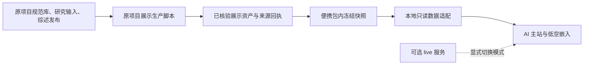

# 代码结构与数据更新

本文件解释“改哪个页面、读哪份数据、怎样更新”的对应关系。结构审查日期为 **2026-11-05**，依据当前 Dashboard 源码及两份展示生产脚本；没有重新计算研究结果。页面语义见[Dashboard 页面与内容约定](04_Dashboard页面与内容约定.md)，数据层与研究分母见[数据资产与统计口径](03_数据资产与统计口径.md)。

## 1. 便携快照与服务器生产是两条路径

本次协作仓库采用 **portable snapshot** 方案：默认从本地随包快照提供页面所需数据，无须连接原服务器。`live` 为可选的真实服务连接模式。模式选择、资源目录与启动方式以仓库根说明及最终 `ui.config.mjs` 为准；协作仓库的路径、构建和代理适配不能直接覆盖原服务器配置。

本次快照交付范围包括 **237,522 条候选记录的 gzip 数据、102 篇可读 AI A/B 综述（其中 B 线 70 篇）、66 篇低空综述**，以及当前页面需要的聚合、关系和分析资产。102 是文章数，不是技术点数；A/B 是不同生成路线。候选记录集不是最新 140,781,506 篇规范论文库，也不是全部 3,119,247 篇 AI 论文的逐条副本。页面统计、候选检索和综述因此各有自己的范围。

前端组件继续使用稳定的请求路径；快照适配层在本地提供相应响应，`live` 模式才连接配置的服务。接口路径看起来像 `/api/...`，不代表默认需要原服务器或需要另行安装原项目数据库。外部论文原文链接仍指向外部网站，随包书目和可读正文则来自冻结快照。

`npm` 的前端构建负责打包代码和已有资产，不会重新做领域筛选、论文去重、八问分析或模型写作。仓库保留服务器生产脚本是为了说明来源与后续衔接，**不意味着仅下载本仓库便可独立运行全部 Python 生产流程**。

## 2. 源码目录与职责

下列路径均相对于协作仓库根目录。

| 目录或文件 | 职责 | 修改时的注意点 |
|---|---|---|
| `web/src/App.vue` | 主站标题、导航、领域选择、初始数据加载与最新库存合并 | 保留五页结构；不要把来源旧样本自动提升成最新全库 |
| `web/src/main.js` | 主路由与旧链接重定向 | 保留查询参数、历史入口、刷新后状态与滚动行为 |
| `web/src/components/` | AI 主站页面、图表、研究模块和低空容器 | 按下表定位页面，不必重写全站 |
| `web/src/helpers/` | 库存适配、年份分桶、活动解析、浮层及播放逻辑 | 同层级组件优先复用，避免各页产生不同口径 |
| `web/src/shared.js` | 请求函数、数字格式、链接处理、来源文案及图表基础 | 是展示基础，不是统计生产器 |
| `web/content/catalog-activity.json` | 人工维护的更新动态及最新交付卡片 | 本文件可人工编辑，是下文“生成值不可直改”的明确例外 |
| `shared/` | 两领域共用标签、浮层、图表呈现和年度播放规则 | 修改后核对 AI 与低空，不只看一侧 |
| `lowalt/src/` | 低空嵌入入口、路由、只读 API 适配、样式与文案适配 | 负责隔离和对接，不混用 AI 数据替代低空 |
| `legacy/src/` | 独立保留的低空页面、组件和配置源码 | 供 `@legacy` 引用；它是实际功能代码，不是可随意删除的历史杂物 |
| `scripts/*.py` | 从原项目已验收输入生成库存和 AI 分析展示资产 | 依赖原项目 `gzk` 包及批次文件；便携包中不默认执行 |
| `ui.config.mjs` | 本仓库资源目录、运行模式、代理及静态资源服务边界 | 原服务器版本与便携版本的环境设置不同，集成时按用途保留 |
| `web/vite.config.js`、`lowalt/vite.config.js`、`build.mjs` | 两侧构建、共享别名和静态资源打包 | 主站与低空都要构建；构建不产生新的研究统计 |

## 3. 页面与数据读取地图

| 页面／功能 | 主要源码 | 数据入口与含义 |
|---|---|---|
| 全站初始数据 | `web/src/App.vue`；`helpers/currentInventory.js` | `/api/llm/bootstrap` 提供已有页面数据；`/chain-analysis/v1/current-inventory.json` 覆盖同 ID 的最新库存条目，旧研究样本仍保留 |
| 数据规模与来源明细 | `OverviewHub.vue`、`DatasetCatalog.vue`；`helpers/foundationSources.js` | 合并后的 `overview`／`inventory`；名称和单位由适配器处理，来源计数及比较契约不因此改变 |
| 更新动态 | `CatalogPulse.vue`；`helpers/catalogActivity.js` | 直接读取 `web/content/catalog-activity.json`，不调用后台采集台账接口 |
| AI 领域数据 | `DataWorkspace.vue`、`DomainHub.vue`、`CurrentDomainInventory.vue` | 最新库存 JSON 支持论文／基金／专利主概览；`/api/llm/analytics` 与 `/api/llm/records` 保留来源专题图和候选记录检索 |
| AI 技术演进 | `EvolutionHub.vue`、`TechnologyEvolutionTree.vue`、`FeaturedTechnologyTimeline.vue` | bootstrap 中 `tree`、`chronology`、`survey`；主题、里程碑和综述身份分别关联 |
| 综述阅读 | `EvolutionHub.vue` | `/api/llm/survey/<topic_id>/<A或B>`；正文、书目、章节导航和引用跳转 |
| AI 原始证据链 | `AiChainWorkspace.vue`、`EvidenceHub.vue`、`FundContribution.vue` | `/api/llm/graph`、`/api/llm/chain-summary`、bootstrap 的 `study`；最新总量与已审样本并存 |
| 投入与产出 | `InvestmentOutcomes.vue`、`InvestmentCurves.vue` | `/chain-analysis/v1/` 下五份 HTML；前四份保留独立展示，曲线组件只提取 `curves.html` 内的 JSON 数据 |
| 研究力量 | `StrengthBase.vue`、`StrengthTrend.vue`、`ResearchAtlas.vue`、`ResearchSuccession.vue`、`EvidenceExplorer.vue` | `/chain-analysis/v1/research.json`，含机构队列、官方身份接续、证据下钻和独立公开成果版图 |
| 低空页面容器 | `LowAltitudeEmbed.vue`；`lowalt/src/App.vue`、`main.js` | `/low-altitude/` 内的独立构建；父子页面同源消息同步路由与高度 |
| 低空功能页 | `legacy/src/views/DataHub.vue`、`ChainHub.vue`；`legacy/src/components/case/TechTreePanel.vue` | `lowalt/src/api.js` 将原 `/api/...` 请求适配为 `/api/low-altitude/...`；快照模式由本地适配提供 |

`TechnologyAtlas.vue`、`TechnologyChronology.vue` 等旧布局组件仍可能保留在源码中；当前主入口实际采用 `TechnologyEvolutionTree.vue` 与重点时间轴。判断当前生效页面应沿导入与路由，不按文件名猜测，也不要因为暂未导入就删除可能用于历史复用的实现。

低空 `main.js` 使用内存路由，并通过同源 `postMessage` 与主站沟通。修改 `LowAltitudeEmbed.vue` 时应同时检查页面切换、查询参数、iframe 高度及浏览器返回；否则常见问题是内部页已变而外层地址未变，或出现双重滚动。

## 4. 共享组件与样式入口

| 功能 | 复用位置 |
|---|---|
| 同级标签、焦点、浮层、遮罩、次级按钮 | `shared/interactions.css` |
| 数字计数 | `web/src/components/CountValue.vue`，两领域共用 |
| 图表包装及交互转发 | `web/src/components/Chart.vue` |
| 图表入场、更新与提示默认样式 | `shared/chartPresentation.js` |
| 研究力量年度播放 | `web/src/helpers/useYearPlayback.js` |
| 四份年度 HTML 播放适配 | `shared/annual-player.js`、`shared/annual-player.css` |
| 弹窗与模态框 | `web/src/helpers/useSurface.js` |
| AI 年份分桶 | `web/src/helpers/aiYearBuckets.js` |
| 研究力量提示框 | `web/src/helpers/strengthTip.js` |
| 主框架与整体视觉 | `web/src/shell.css`、`style.css` 及相应页面样式 |
| 研究力量视觉 | `web/src/strength.css` |
| 低空嵌入视觉／文案 | `lowalt/src/embed.css`、`displayCopy.js` |

`displayCopy.js` 在构建时定向适配低空展示文案；`api.js` 还会规范少量目录名称。这些是展示适配，不应改变原 API 数量、题名、来源证据或成果类型。

## 5. 两份 Python 生产脚本究竟做什么

以下输入位置**相对于原项目根目录**，用于追溯批次。它们不是协作仓库内可保证存在的文件，也不是启动便携快照所需的下载清单。脚本还依赖原项目 `gzk.paths.ROOT` 与 `manage.py` 运行方式。

### `scripts/build_current_inventory.py`

读取论文、专利、关系交付的质量回执与年度表，做跨批数量一致性断言，生成 17 项库存／关系资源、最新数量、AI 年份、论文类型与字段覆盖。它不直接查询或修改原数据库。

| 原项目相对输入 | 用途 |
|---|---|
| `data/outputs/shared/paper_inventory/paper_unified_20261030_v1/quality.json` | 规范论文总数、AI 数量、类型、字段、年度及关系对账 |
| `data/outputs/shared/patent_inventory/patent_unified_20261030_v1/质量回执.json` | 全国／AI 专利数量与 verified 状态 |
| 同专利版本下 `AI专利_年份分布.csv` | 申请年及公开年序列 |
| `data/outputs/shared/innovation_relations/innovation_relations_20261102_v1/quality.json` | 关系库数量与各项验收状态 |
| 同关系版本下 `annual_project_coverage.csv` | AI 项目批准年覆盖 |
| `data/runs/llm/innovation/relations_review_20261103_v1/relations_year_audit.json` | 基金关联论文数量、缺年和年度分布 |

原项目输出是 `data/outputs/shared/ui_handoff/cursor_20260924/analysis_public/chain-analysis/v1/current-inventory.json`，来源 SHA 回执另存于同展示交付目录的 `verification/current_inventory_20261103/sources.json`。页面使用的是 `/chain-analysis/v1/current-inventory.json`；便携构建可将其放在本地静态资产目录，不需要保留原物理输出路径。

日期与版本在现有脚本内写明。换入新源文件时应同步新版本及适用范围，不能只替换数值继续沿用旧 `as_of`，也不能直接修改生成 JSON 跳过数量断言。

### `scripts/build_ai_chain.py`

完整执行先调用 `build_current_inventory.py`，然后组合研究力量、接续证据、公开成果版图与五份投入产出 HTML，输出 `research.json` 及 HTML。它消费已验收材料，不负责重新跑八问模型、重筛全部数据或生成新综述。

主要输入分三组：

1. `data/outputs/shared/innovation_research/claude_research_design_handoff_20261103_v1/Claude_研究力量展示设计交接包/`：`关系明细/真实关系原始结构.json`，以及 `数据表/01_首页七项数据.csv`、`02_基金年度支持概览.csv`、`03_2021机构支持构成.csv`、`04_全部机构年度项目.csv`、`05_168机构后续成果足迹.csv`。
2. `data/runs/llm/innovation/`：`research_graph_focus_20261103_v2/verified_institution_data.json`、`research_graph_branches_20261103_v3/verified_branch_data.json`、同批 `case_content_evidence.json`，以及 `relations_review_20261103_v1/institution_analysis.json`。
3. 下面列出的五份已验收分析 HTML，以及本仓库对应的共用年度播放脚本和样式。

脚本断言 286 条接续、278 个身份、242 项目、2,971 论文节点、研究力量 7,032 项／727 机构及 168 家新增观察机构。首页七项指标会按名称更新为最新库存值，而机构队列与接续样本保持自身范围。`public()` 移除部分服务器定位和内部操作字段；研究字段和引用继续保留。

输出资产位于同一 `chain-analysis/v1/` 发布目录，输入 SHA、产物说明及关键断言写入展示交付目录的 `analysis_v1_sources.json`。因此单独复制 `research.json` 可以阅读已生成页面，但不等于具备重新生产它的全部原输入。

`--animations-only` 只重新生成五份展示 HTML 并更新既有来源摘要；不重算研究数据，也不生成 `research.json`。该分支仍依赖五份原 HTML、共享播放代码、已存在的输出目录和来源摘要，**不是无依赖的便携构建命令**。

## 6. 五份分析 HTML 的来源

下表右侧相对于原项目的 `data/outputs/shared/innovation_research/`。日期后缀是研究版本，不因前端打包而变成新计算日期。

| 页面请求资产 | 冻结来源 |
|---|---|
| `chain-analysis/v1/funding.html` | `red_animations_20261027_v9/1.1_在研项目批准经费_人大红.html` |
| `chain-analysis/v1/outputs.html` | `seven_layer_patent_20261027_v1/2.1_七大层_论文与专利年度动画.html` |
| `chain-analysis/v1/funding-terms.html` | `keyword_tiles_20261027_v2/1.1_70技术点投入演进.html` |
| `chain-analysis/v1/output-terms.html` | `patent_terms_reclassified_20261027_v2/2.1_论文与专利_专利逐年播放.html` |
| `chain-analysis/v1/curves.html` | `patent_terms_reclassified_20261027_v1/七大技术方向_投入与产出曲线_专利重分类.html` |

生产脚本对前四份追加 `annual-player.css`／`.js`，保留原数据序列；`curves.html` 不追加该播放层。`InvestmentCurves.vue` 读取 `script#data` 的 JSON 并用原生图表展示，不执行整个 HTML 脚本。调整曲线外观应改组件；调整研究序列应在原研究生产流程形成新成果后重新交付。

不得直接改 HTML 内嵌数值、年份、分摊或类别以配合画面；也不要把图表自带的旧播放脚本重新启用，覆盖当前默认最后一年、手动播放、每秒一年、结束停止的共同规则。

## 7. 研究力量版图另有一类策展内容

`build_ai_chain.py` 中的 `LANDSCAPE_GROUPS`、`LANDSCAPE_EVENTS`、`LANDSCAPE_FLOWS`、`LANDSCAPE_NOTES`、`LANDSCAPE_ERAS` 是代码内维护的公开成果版图内容。当前有 67 个成果事件；这部分并非由基金库、286 条人员接续或机构队列自动推导。

事件包含年份／月份、机构、描述、开放状态、重点标记及可选 URL。部分事件和流动条目目前 URL 为空；现有设计被采用不等于每条外部事实在本轮重新核验。该部分应作为独立策展版本维护：新增成果、修改年份、开放状态或机构关系时补直接来源，未核实内容不要提升为新的研究结论。

本次代码审查只确认其生成来源和字段，没有联网重新核查每条事件。不要用这些节点数量计算基金贡献、人才流动率或国家技术份额，也不要从机构主干的图示起点推断成立时间。

## 8. 按修改类型选择更新入口

| 要做的事 | 应修改／更新什么 | 不应同时发生的事 |
|---|---|---|
| 配色、排版、图表表现、交互 | 对应 Vue／CSS／共享组件，随后构建及检查受影响页面 | 不改 JSON 数字、统计分母、关系含义或综述正文 |
| 补充更新动态 | `web/content/catalog-activity.json`，通过同一解析规则验证并重新发布静态内容 | 不把台账事件当新规范记录，不同步覆盖后台资产台账 |
| 更新规范库规模 | 原项目验收新批次 → 更新库存生产输入与版本 → 生成新 JSON／回执 → 更新便携快照 | 不在页面或 `current-inventory.json` 手工填新总数 |
| 更新研究力量／接续 | 原项目复核队列／关系与来源 → 更新交接表及相应生产逻辑 → 新发布资产 | 不把全量候选当官方确认子集，不因数据变大沿用旧结论 |
| 更新投入产出序列 | 对应研究生产器生成新分析 HTML／底表，核对样本后再适配 | 不直接编辑五份展示 HTML 的内嵌序列 |
| 更新技术树、时间节点、综述 | 维护词表／事件／正文的正式内容版本并核查证据，再导出快照 | 不用前端检索结果数量充领域规模，不为版面改写引用 |
| 更新本地快照 | 按根说明的导出／清单流程替换一组完整数据并核对版本、数量和 SHA | 不临时请求服务器兜底后仍声称完全离线，不只更新总数而漏更新对应索引 |
| 将协作改动集成回服务器 | 按源码差异合并，经服务器自己的配置、备份与验收流程发布 | 不整包覆盖服务器 `ui.config.mjs`、构建路径、服务配置或数据库 |

除人工活动台账和明确的策展源内容外，生成的库存 JSON、关系 JSON、统计快照、分析 HTML 内嵌数据及综述展示包都不应作为手工编辑入口。保持“源内容／生产规则 → 已核验发布资产 → 页面读取”的方向，才能在后续数据更新时复用本次界面工作。

## 9. 仍须随仓库清单确认的内容

便携快照的最终物理目录、请求索引、gzip 分片及导出命令由本次打包适配确定，应以仓库根说明和实际文件为准；本文件使用稳定请求路径避免绑定原服务器目录。快照中保留的来源证据不等于原始大库、所有 CSV 底表或研究运行环境已随包提供。

独立开发至少能完成页面修改、本地快照阅读与前端构建。需重算数据时先核对原生产依赖是否另行交付；缺少输入就保持现有冻结版本，并提出具体的输入／字段需求，不能用合成数补成新的研究结果。

核验依据：`scripts/build_current_inventory.py`、`scripts/build_ai_chain.py`、当前主站与低空路由／API 适配源码、五份分析资产映射及共用交互实现。便携包规模依据本次主协调的导出范围；原项目业务数据库在本次审查中保持只读，未执行生产脚本。

## 研究团队代表案例与接续证据（2026-11-09）

代表案例由 `scripts/strength_cases.json` 维护，按官方团队研究方向与本库经官方人员ID核验的接续记录共同筛选。当前六位：黄民烈、陈华钧、张伟楠、张兆翔、张长水、曹刘娟；配置保存官方来源、选择理由和研究问题摘要。公开介绍用于解释代表性，基金关系仍以库内记录为依据。

`build_strength_cases.py` 只读关联库，抽取十家机构974个AI项目、10382篇2017—2025年论文、11129对项目论文关系，保留原286条接续统计口径。项目筛选窗口2017—2025，实际批准年份2017—2023；执行期使用原始起止日期。人物按已核验身份合并，未核验者仍按项目分别展示。不可因同名自行合并。

所有人物使用 `ProjectTimeline.vue` 与 `helpers/projectTimeline.js`：实际批准年标记、执行期色带、按发表年去重的关联论文节点；缺日期只画已有信息，不推算执行期限。机构图每组展示10位负责人，可搜索、翻组；已核验接续及代表人物优先。

服务器通过 `manage.py run dashboard/cursor_ui/scripts/build_strength_cases.py --input <research.json> --output <隔离输出research.json>` 生成并核验；固定DuckDB依赖运行在服务器Python3.13，manage入口会转交兼容解释器。完整 `build_ai_chain.py` 已接入这一扩展步骤。修改快照时必须同时更新 `snapshot/manifest.json` 对应资产SHA；数据库及原始材料不入Git。

2026-11-09补充：代表案例加入中国人民大学金琴（2017、2020两期面上项目，多模态智能方向），保留此前六人。接续证据扩展至11家机构、1,025个项目、11,038篇论文、11,815条项目—论文关系。桑基图三条主要流向共用同一标注模板，统一显示百分比、分子/分母及起点项目类型；单位为接续记录“条”，不等同去重人数。原286条接续总体保持不变。本轮运行依据见data/runs/llm/innovation/strength_ruc_20261109。
